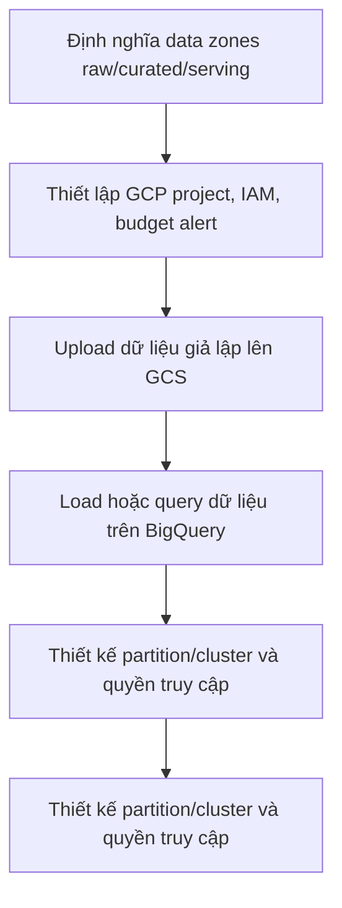

# Cloud Data Lake & Warehouse

**Module 02 — Cloud Analytics Engineering · Project 05 | OmniCommerce Data Platform**

> Đưa dữ liệu OmniCommerce lên cloud, tổ chức raw/curated/serving datasets, xây dựng warehouse phân tích có quản trị chi phí.

**Trạng thái: Planned — repository định hướng học tập, CHƯA có implementation.** README này trình bày phạm vi dự kiến, không phải tuyên bố hệ thống đã chạy hoặc đạt benchmark.

## 1. Tổng quan và bài toán nghiệp vụ

OmniCommerce là doanh nghiệp thương mại điện tử giả lập dùng xuyên suốt lộ trình Data Engineering. **Bài toán của Project 05:** Dữ liệu on-premise/local bắt đầu tăng nhanh; đội phân tích cần kho dữ liệu cloud có khả năng truy vấn và phân quyền mà không vận hành server cơ sở dữ liệu thủ công.

Dự án được thiết kế để chứng minh không chỉ khả năng dùng công cụ mà cả cách phân tích yêu cầu, thiết kế giải pháp, nhận diện tình huống lỗi, kiểm thử và vận hành có thể giải thích được.

## 2. Mục tiêu và giá trị mang lại

- **Business goal:** Đưa dữ liệu OmniCommerce lên cloud, tổ chức raw/curated/serving datasets, xây dựng warehouse phân tích có quản trị chi phí.
- **Engineering goal:** Hiểu kiến thức nền tảng, nắm trade-offs, viết implementation có test và tài liệu thiết kế.
- **Portfolio goal:** Có demo tái lập được, requirements, architecture/ADR, test evidence và hướng dẫn vận hành.
- **Phạm vi nguồn dữ liệu:** Dữ liệu sạch từ Python ETL và PostgreSQL.

**Kết quả dự kiến:** một dự án có thể trả lời rõ *tại sao xây dựng*, *đầu vào/đầu ra là gì*, *hành vi khi lỗi*, *cách kiểm tra* và *giới hạn hệ thống*.

## 3. Technology Stack (dự kiến)

| Nhóm | Công nghệ / chủ đề | Vai trò |
|---|---|---|
| Core tools | Google Cloud Platform, Cloud Storage (GCS), BigQuery, IAM, gcloud CLI, SQL, Python, Terraform (tùy milestone) | Xây dựng các thành phần chính theo từng milestone |
| Engineering knowledge | Cloud projects/billing, service accounts, IAM least privilege, object storage, partitioning, clustering, load jobs, external tables, cost estimation | Kiến thức phải hiểu và có thực hành trước khi đánh dấu hoàn thành |
| Documentation | Markdown, Mermaid, ADR, runbook | Ghi lại kiến trúc và quyết định |
| Verification | Tests, fixtures, failure injection, benchmark khi phù hợp | Chứng minh hành vi thay vì chỉ mô tả |

**Nguyên tắc:** Công nghệ có thể thay đổi khi phân tích trade-offs. Không cài đặt tất cả cùng lúc; chỉ thêm công cụ khi có bài toán yêu cầu.

## 4. Kiến trúc mục tiêu — Conceptual Workflow


definition: mô tả một luồng logic dự kiến, chưa phải sơ đồ của hệ thống đang chạy.



**Điểm cần xác định trong System Design:** dữ liệu đầu vào, hợp đồng dữ liệu/schema, nơi lưu trạng thái, boundary transaction/idempotency, lỗi tạm thời vs lỗi vĩnh viễn, monitoring và các giới hạn mở rộng.

## 5. Functional Requirements

| ID | Requirement | Trạng thái |
|---|---|---|
| FR-01 | Quản lý bucket và dữ liệu có tổ chức | Chưa triển khai |
| FR-02 | Load dữ liệu vào BigQuery có schema | Chưa triển khai |
| FR-03 | Phân quyền service identity phù hợp | Chưa triển khai |
| FR-04 | SQL analytics trên warehouse cloud | Chưa triển khai |
| FR-05 | Theo dõi chi phí và kết quả query | Chưa triển khai |
| FR-06 | Quy trình chạy lại/backfill được tài liệu hóa | Chưa triển khai |

Các yêu cầu sẽ được tách thành tickets nhỏ, mỗi ticket có inputs/outputs, các trường hợp lỗi và acceptance tests trước khi implementation.

## 6. Non-functional Requirements

- **NFR-01:** Secrets không commit.
- **NFR-02:** Có ngân sách và cảnh báo tránh chi phí bất ngờ.
- **NFR-03:** Data access theo least privilege.
- **NFR-04:** Có dữ liệu demo có thể tái lập.


Không tự đặt ra kết quả như “exactly-once”, “99.9% uptime”, “tối ưu 30% chi phí” hoặc “xử lý 1 triệu events/s” trước khi có phạm vi và phép đo xác thực.

## 7. Engineering Challenges & Trade-offs

- **Challenge 01:** Billing không kiểm soát. Cần document các phương án, điều kiện áp dụng và test kiểm chứng.
- **Challenge 02:** Partition pruning và scan quá nhiều bytes. Cần document các phương án, điều kiện áp dụng và test kiểm chứng.
- **Challenge 03:** Schema drift của nguồn. Cần document các phương án, điều kiện áp dụng và test kiểm chứng.
- **Challenge 04:** IAM quá rộng. Cần document các phương án, điều kiện áp dụng và test kiểm chứng.


## 8. Milestones / Learning Roadmap

| Milestone | Nội dung và deliverable dự kiến | Tiến độ |
|---|---|---|
| M1 | GCP foundations, IAM và cost control | Chưa bắt đầu |
| M2 | GCS zones và data load | Chưa bắt đầu |
| M3 | BigQuery modeling và SQL | Chưa bắt đầu |
| M4 | Performance/cost benchmarks | Chưa bắt đầu |
| M5 | Operations, cleanup và handoff | Chưa bắt đầu |

**Cách học mỗi checkpoint:** Problem → Concept → Tiny Example → Feynman (≥ 8/10) → Implementation → Tests/Evidence → Commit Git. Học từng khái niệm, không học dồn nhiều kỹ thuật trong một lần.

## 9. Acceptance Criteria — Definition of Done

- [ ] **AC-01:** Có pipeline mẫu local → GCS → BigQuery.
- [ ] **AC-02:** Có truy vấn KPI đúng và được đối soát.
- [ ] **AC-03:** So sánh bytes scanned/cost trước-sau tối ưu.
- [ ] **AC-04:** Có tài liệu teardown tránh chi phí cloud.

- [ ] Có README phản ánh đúng khả năng hiện tại, không nhầm planned với implemented.
- [ ] Có tài liệu kiến thức, architecture/ADR và runbook tương ứng khi cần.
- [ ] Test evidence ghi rõ environment, input, command, expected/actual và hạn chế.

**Hoàn thành:** Chỉ chuyển milestone/requirement sang Completed khi có code chạy thực tế và evidence phù hợp, không phải khi mới có tài liệu mô tả.

## 10. Repository Structure (định hướng, chưa tạo)

```text
gcp-cloud-data-lake-warehouse/
├── README.md                 # Hiện tại chỉ có file này
├── docs/                     # Tạo khi có bài học/requirements/ADR
│   ├── 01-knowledge/
│   ├── 02-design/
│   ├── 03-decisions/
│   ├── 04-operations/
│   └── 05-evidence/
├── src/ hoặc scripts/         # Tạo khi bắt đầu code
├── tests/                    # Tạo cùng implementation
└── config/                   # Tạo khi cần môi trường
```

**Lưu ý:** Không tạo thư mục trống chỉ để trông như dự án đã triển khai. Không commit credentials, PII thật, dumps hoặc runtime data nhạy cảm.

## 11. Current Progress & Next Steps

| Nội dung | Trạng thái |
|---|---|
| Business problem, goals, technology scope, draft requirements | Planned trong README |
| Source code / working pipeline | Chưa triển khai |
| Unit / integration / failure tests | Chưa triển khai |
| Benchmarks và kiểm thử vận hành | Chưa triển khai |

**Bước đầu tiên khi bắt đầu Project 05:** Xác minh lại business scenario và requirements, học khái niệm nền tảng đầu tiên, sau đó tạo ticket nhỏ có acceptance criteria. AI Agent chỉ được giao implementation sau khi đã đủ rõ đầu vào, đầu ra, edge cases và cách review.

## 12. Liên kết trong lộ trình

- **Module:** 02 — Cloud Analytics Engineering.
- **Project:** 05/11.

